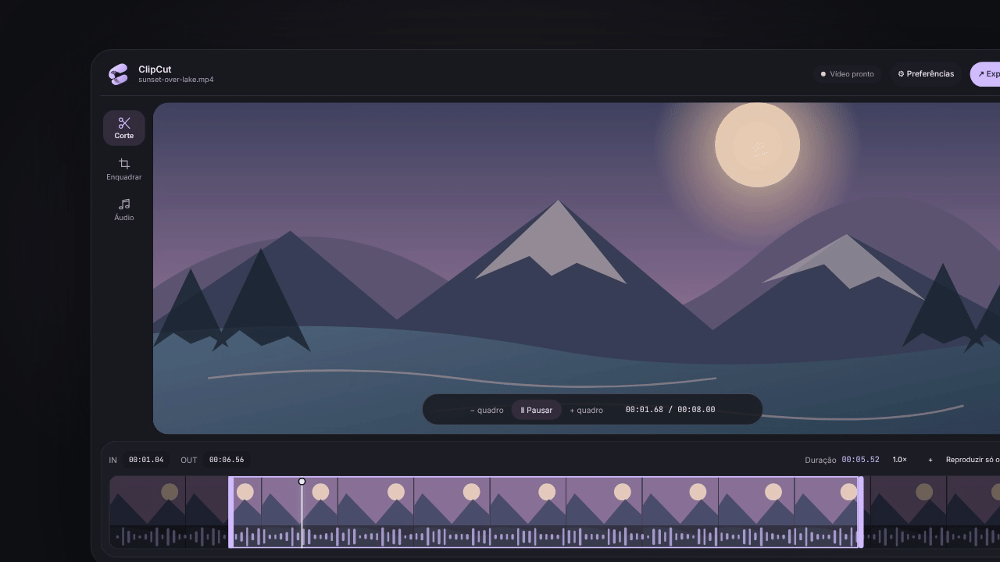

# ClipCut

O ClipCut é um projeto pessoal: um editor de vídeo local pensado para cortar clipes com facilidade e praticidade, sem depender de um fluxo pesado de edição. Ele permite reproduzir, selecionar, enquadrar e exportar trechos; PySide6 e Qt Quick compõem a interface, enquanto FFmpeg e ffprobe cuidam da mídia. Os arquivos permanecem no computador.

## Prévia animada



🎬 [Assistir ao vídeo promocional completo (MP4, 1080p, 32 s)](assets/promo/clipcut-promo-1080p.mp4)

O vídeo promocional e seu projeto Remotion ficam em [`promo/`](promo/README.md). A interface do vídeo é reconstruída em React/CSS a partir dos componentes e tokens QML reais; a prévia dentro do player é uma ilustração original gerada por código.

## Interface

O tema padrão combina superfícies escuras, detalhes lavanda e controles compactos. Em **Preferências → Aparência**, é possível alternar entre o tema do ClipCut e as cores do KDE Plasma quando disponíveis; também há uma opção para reduzir animações.

## Requisitos e execução

- Python 3.10 ou superior.
- PySide6 6.8 ou superior, com os módulos QML Qt Quick, Controls, Dialogs, Layouts, Effects, Shapes, VectorImage e Qt Multimedia.
- FFmpeg e ffprobe acessíveis pelo `PATH`.
- Para codificação por GPU, drivers e encoders compatíveis na instalação do FFmpeg (opcional).

```sh
python -m pip install -r requirements.txt
python main.py
```

Instale o FFmpeg pelo gerenciador de pacotes do seu sistema antes de iniciar o app.

## Fluxo

1. Abra um vídeo com **Abrir** ou arraste um arquivo local para a janela. Caminhos com espaços e Unicode são aceitos.
2. Reproduza na prévia. Use os controles flutuantes, mute e o painel **Áudio** para o volume.
3. Use **Espaço** para pausar/retomar, **I/O** para marcar IN/OUT e **←/→** para avançar um quadro. Edite os tempos na faixa de seleção ou arraste as alças da timeline. Use **+ / −** ou **Ctrl+roda** para zoom (até 4×), **Shift+roda** para navegar e duplo clique para ajustar o clipe inteiro. A timeline usa até 48 miniaturas individuais, revela mais amostras conforme o zoom e preserva a proporção dos quadros. Quando houver áudio, mostra uma waveform de picos; sem faixa de áudio, indica isso na própria timeline.
4. Use **Enquadrar** para proporções Original, 4:3, 16:9, 21:9, vertical 9:16, quadrada 1:1, retrato 4:5 ou Livre (ex.: `3:2`); reposicione a moldura diretamente sobre o vídeo.
5. **Exportar** abre um painel contextual para codec, encoder (CPU/GPU quando compatível), qualidade, proporção, áudio, tamanho-alvo e pasta. A última pasta escolhida permanece como destino padrão nas próximas exportações. Exporte imediatamente ou adicione o corte à fila; cada item guarda as opções e o intervalo escolhidos. A preferência de encoder também fica em Preferências. Escolha o nome e formato (`.mp4`/`.mkv`); se já existir, o app pede confirmação antes de substituir.

Durante a renderização, o editor fica desfocado e bloqueado; o cartão central mostra o progresso e mantém **Cancelar** disponível.

## Precisão e exportação

- H.264, HEVC, AV1 e cópia do vídeo usam encoders disponíveis no FFmpeg. Valores de qualidade são específicos de cada encoder.
- A escolha entre CPU e GPU é explícita no painel de exportação. A disponibilidade de NVENC, AMD AMF, Intel Quick Sync ou VA-API depende da GPU, do driver e dos encoders do FFmpeg. Se o encoder GPU selecionado falhar ao iniciar, a exportação informa o erro em vez de trocar silenciosamente para CPU. Algumas GPUs não codificam certos codecs por hardware: por exemplo, a RTX 3060 Ti não oferece codificação AV1; nesse caso, AV1 usa CPU e a opção GPU fica indisponível.
- **Preferências → Diagnóstico de exportação** mostra as versões e os encoders detectados e permite copiar um relatório. Ele não inclui caminhos de mídia; confira o modelo da GPU antes de compartilhar.
- O áudio selecionado é codificado em AAC estéreo a 192 kb/s; pode ser excluído no painel de exportação.
- Enquadrar exige recodificação e não funciona com vídeo sem recodificação. Tamanho-alvo usa bitrate estimado de uma passagem e não promete tamanho exato.
- A posição do player usa milissegundos. Botões de quadro usam o FPS médio e não garantem avanço exato em vídeos com taxa variável.
- Vídeo sem recodificação pode ajustar os pontos de corte a quadros-chave; recodificar é a opção mais precisa.
- A exportação usa arquivo temporário, valida pacotes de vídeo e publica por rename atômico. Falha/cancelamento não substitui destino existente. O original é rejeitado.

## Verificações

```sh
python -m unittest discover -s tests -v
qmllint Main.qml DesignTokens.qml components/*.qml
```

Os testes cobrem proporções, enquadramento, seleção de encoder, exportação e proteção contra sobrescrita. A disponibilidade dos módulos Qt e do `qmllint` varia conforme a instalação do Qt.

## Pacotes Windows

O workflow de builds publica o ZIP portátil e o instalador MSI como artefatos do GitHub Actions. Ambos incluem o aplicativo e as dependências Qt/Python; FFmpeg e ffprobe devem ser instalados separadamente e estar no `PATH`.

## Licença

O ClipCut é distribuído sob a licença MIT; consulte o arquivo `LICENSE`. PySide6/Qt e FFmpeg são dependências externas e mantêm suas próprias licenças. Ao redistribuir uma versão empacotada, verifique e inclua os avisos aplicáveis às versões e builds utilizadas.
